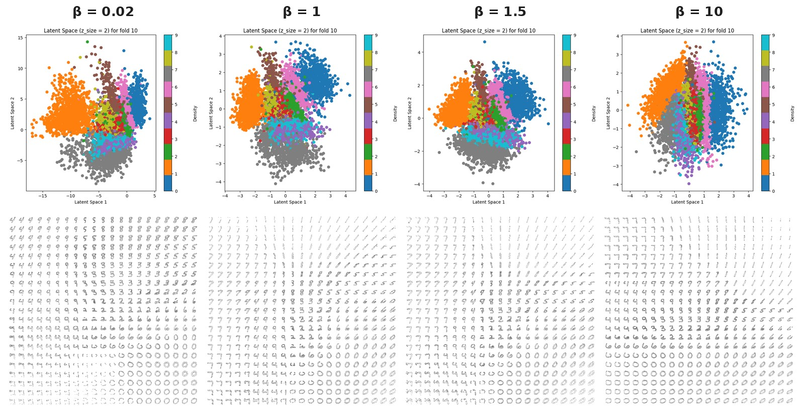
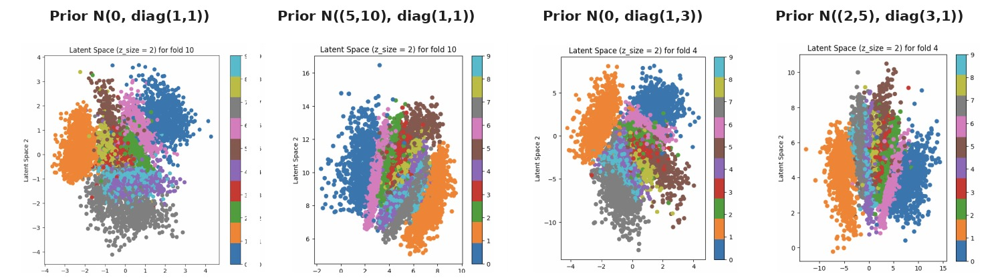

# Understanding Autoencoders and Variational Autoencoders

**Regis Konan Marcel Djaha** · **[Iñigo Urteaga](https://iurteaga.github.io/)**
Basque Center for Applied Mathematics (BCAM), Statistical Machine Learning group · African Master's in Machine Intelligence (AMMI)

📄 **Master's project report:** [Regis_Djaha_AMMI_project_2023.pdf](reports/Regis_Djaha_AMMI_project_2023.pdf) · 🌐 [Project page](https://regiskonan.github.io/projects/ae-vae/)

This repository studies how the main design choices of **Autoencoders (AEs)** and **Variational Autoencoders (VAEs)** shape what they learn:

- **network depth**, i.e. the number of encoder/decoder layers $n_L$;
- **latent dimension** $D_z$;
- **prior distribution** of the VAE;
- **β-weighting** of the KL term (β-VAE).

Experiments are run on **MNIST**, **FashionMNIST** and **FreyFace**, with PyTorch.

<p align="center">
  
  <br><em>Effect of β on a VAE trained on MNIST (n<sub>L</sub> = 2, D<sub>z</sub> = 2). Top: latent space coloured by digit. Bottom: images decoded from a grid of latent points.</em>
</p>

## Key findings

- **VAE vs AE:** the VAE latent space is better structured and centred around the origin, with dimensions roughly following a standard normal distribution. This makes it much better suited to interpolation and to generating new, class-distinguishable samples.
- **Prior choice:** with any of the Gaussian priors tested, the latent space stays organised into clusters. Shifting the prior mean moves the clusters, and anisotropic variances stretch them.
- **β-weighting:** β controls the trade-off between reconstruction quality and latent regularisation. A small β gives sharper reconstructions but a less regular latent space; a large β gives a smoother, more Gaussian latent space at the cost of detail.

<p align="center">
  
  <br><em>VAE latent spaces on MNIST (D<sub>z</sub> = 2) under four different Gaussian priors.</em>
</p>

## Repository structure

```
ae_vae_understanding/
├── src/
│   ├── models.py               # AE, and VAE with Encoder / Decoder
│   ├── main/
│   │   ├── datasets.py         # MNIST, FashionMNIST, FreyFace loaders
│   │   └── loss_function.py    # reconstruction + KL losses (standard or mean-conditional Gaussian prior)
│   └── utilities/              # latent-space sampling, plotting, trained-model helpers
├── script/                     # experiment and analysis scripts (see below)
├── notebooks/                  # step-by-step notebooks: AE, VAE, VAE priors, β-VAE
├── data/FreyFace/              # FreyFace dataset (MNIST and FashionMNIST are downloaded automatically)
├── results/                    # example outputs (metrics, latent spaces, reconstructions)
├── reports/                    # Master's project report and presentation
└── figures/                    # figures used in this README
```

## Installation

```bash
git clone https://github.com/RegisKonan/ae_vae_understanding.git
cd ae_vae_understanding
```

**With conda:**
```bash
conda create -n vae python=3.12
conda activate vae
pip install -r requirements.txt
```

**Or with virtualenv:**
```bash
python -m venv env
source env/bin/activate        # Windows: env\Scripts\activate
pip install -r requirements.txt
```

## Running the experiments

Run all scripts from the root of the repository. Common options:

| Option | Values |
|---|---|
| `-dataset_name` | `MNIST`, `FashionMNIST`, `FreyFace` |
| `-model_name` | `AE`, `VAE` |
| `-n_L` | number of encoder/decoder layers |
| `-D_z` | latent dimension |

### 1. Effect of depth: fixed $D_z$, varying $n_L$

```bash
python script/AE_VAE_experiment_nL.py -dataset_name FreyFace -model_name AE -n_L 3 7 -D_z 5
```

### 2. Effect of latent dimension: fixed $n_L$, varying $D_z$

```bash
python script/AE_VAE_experiment_Dz.py -dataset_name FashionMNIST -model_name VAE -n_L 3 -D_z 2 5
```

### 3. Effect of the VAE prior

The loss function supports two priors (`kl_div` argument in [`src/main/loss_function.py`](src/main/loss_function.py)):

- `standard_gaussian`: $p(z) = \mathcal{N}(0, I)$ (default);
- `mean_conditional_gaussian`: $p(z) = \mathcal{N}(\mu_2, \mathrm{diag}(\sigma_2^2))$, with mean `mean_2` and variance `var_2` set by the user.

To reproduce the prior experiments, change the `'kl_div'` entry of the model configuration to `"mean_conditional_gaussian"` (and set `mean_2` / `var_2`) in the scripts of sections 1–2, then run them as above. The notebook [`notebooks/VAE_priors`](notebooks/VAE_priors) shows the full procedure.

### 4. β-VAE: fixed $n_L$ and $D_z$, varying β

```bash
python script/beta_VAE_experiment.py -dataset_name MNIST -model_name VAE -beta 0.02 1 1.5 10 -n_L 2 -D_z 2
```

### 5. Plots and analysis

These scripts produce the metric curves, latent-space plots, original vs reconstructed images, and parameter counts:

```bash
python script/Run_code_AE_VAE.py   -dataset_name FreyFace -model_name AE  -n_L 1 -D_z 2
python script/Run_code_beta_VAE.py -dataset_name FreyFace -model_name VAE -beta 0.02 1 1.5 10 -n_L 1 -D_z 5
```

## Notebooks

The [`notebooks`](notebooks) folder walks through each study step by step:

| Notebook | Topic |
|---|---|
| `AE/` | Impact of network architecture on AEs |
| `VAE/` | Impact of network architecture on VAEs |
| `VAE_priors/` | Impact of the prior distribution |
| `beta_VAE/` | Impact of β on the VAE loss and performance |

```bash
jupyter notebook
```

## Contact

Questions or issues: open a GitHub issue or contact Regis at [regiskonan056@gmail.com](mailto:regiskonan056@gmail.com).

## Acknowledgments

We thank the "la Caixa" Junior Leader programme (award LCF/BQ/PI22/11910028) for financial support of this work.

## License

This project is released under the terms of the [GPL-3.0 License](LICENSE).
